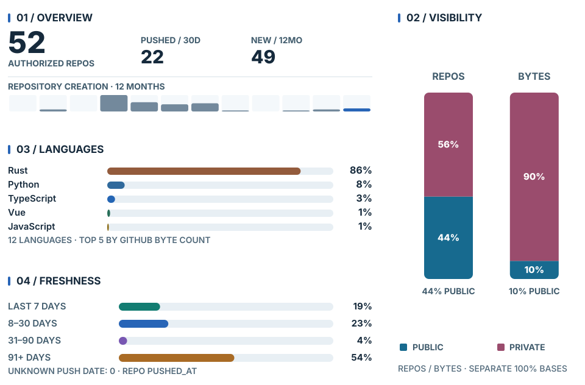

## Who I Am  

I’m a full‑stack engineer who builds **high‑performance, privacy‑preserving, cloud‑native** systems. My work spans financial data pipelines, low‑level networking, edge‑aware services, and a suite of internal tools for the **SignalArk** platform. I write production‑grade code in **Rust, Python, TypeScript**, and I focus on writing clean, testable, and well‑documented software that scales.  

## Contact  

- **GitHub:** https://github.com/pylab-me

If you’re looking for a developer who can deliver **production‑grade, privacy‑aware, high‑performance software**, let’s talk. I’m eager to bring my expertise to your team.

<!-- PROFILE_METRICS:CARDS:START -->

  <picture>
    <source media="(max-width: 600px) and (prefers-color-scheme: dark)" srcset="https://raw.githubusercontent.com/pylab-me/.github/main/assets/metrics/dashboard-mobile-dark.svg?v=3f51b5c2d570" />
    <source media="(max-width: 600px)" srcset="https://raw.githubusercontent.com/pylab-me/.github/main/assets/metrics/dashboard-mobile-light.svg?v=02c6003c0fbe" />
    <source media="(prefers-color-scheme: dark)" srcset="https://raw.githubusercontent.com/pylab-me/.github/main/assets/metrics/dashboard-desktop-dark.svg?v=30cdb13bec35" />
    
  </picture>

<!-- PROFILE_METRICS:CARDS:END -->
