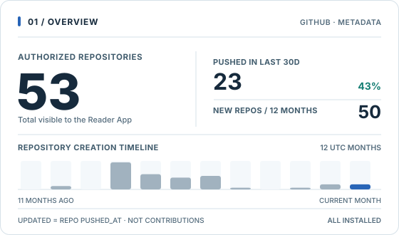
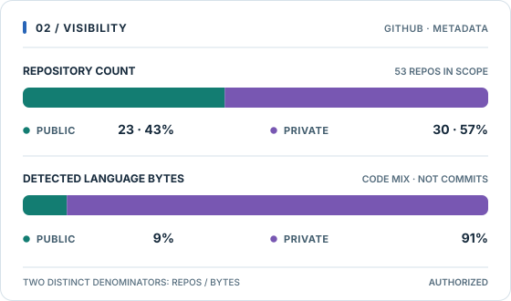
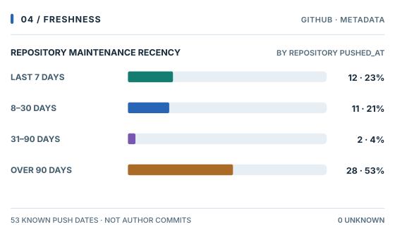

## Who I Am  

I’m a full‑stack engineer who builds **high‑performance, privacy‑preserving, cloud‑native** systems. My work spans financial data pipelines, low‑level networking, edge‑aware services, and a suite of internal tools for the **SignalArk** platform. I write production‑grade code in **Rust, Python, TypeScript**, and I focus on writing clean, testable, and well‑documented software that scales.  

## Contact  

- **GitHub:** https://github.com/pylab-me

If you’re looking for a developer who can deliver **production‑grade, privacy‑aware, high‑performance software**, let’s talk. I’m eager to bring my expertise to your team.

<!-- PROFILE_METRICS:CARDS:START -->

  <picture>
    <source media="(prefers-color-scheme: dark)" srcset="https://raw.githubusercontent.com/pylab-me/.github/main/assets/metrics/overview-dark.svg?v=ff94bd86ad04" />
    
  </picture>
  <picture>
    <source media="(prefers-color-scheme: dark)" srcset="https://raw.githubusercontent.com/pylab-me/.github/main/assets/metrics/visibility-dark.svg?v=26ceb4276e13" />
    
  </picture>

  <picture>
    <source media="(prefers-color-scheme: dark)" srcset="https://raw.githubusercontent.com/pylab-me/.github/main/assets/metrics/languages-dark.svg?v=290994ae349a" />
    
  </picture>
  <picture>
    <source media="(prefers-color-scheme: dark)" srcset="https://raw.githubusercontent.com/pylab-me/.github/main/assets/metrics/freshness-dark.svg?v=873895570e77" />
    
  </picture>

<!-- PROFILE_METRICS:CARDS:END -->
