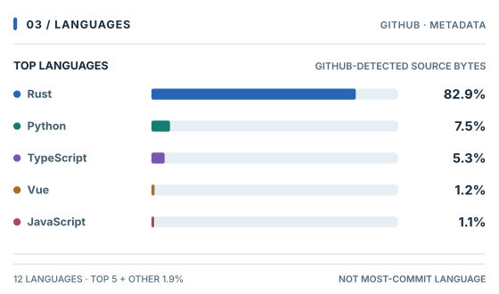
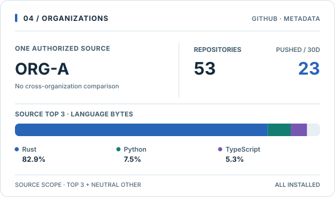

## Who I Am  

I’m a full‑stack engineer who builds **high‑performance, privacy‑preserving, cloud‑native** systems. My work spans financial data pipelines, low‑level networking, edge‑aware services, and a suite of internal tools for the **SignalArk** platform. I write production‑grade code in **Rust, Python, TypeScript**, and I focus on writing clean, testable, and well‑documented software that scales.  

## Contact  

- **GitHub:** https://github.com/pylab-me

If you’re looking for a developer who can deliver **production‑grade, privacy‑aware, high‑performance software**, let’s talk. I’m eager to bring my expertise to your team.

<!-- PROFILE_METRICS:CARDS:START -->
<table width="100%" align="center">
  <tr>
    <td width="50%" align="center">
      <picture>
        <source media="(prefers-color-scheme: dark)" srcset="https://raw.githubusercontent.com/pylab-me/.github/main/assets/metrics/overview-dark.svg?v=dcb0532cc8f0" />
        
      </picture>
    </td>
    <td width="50%" align="center">
      <picture>
        <source media="(prefers-color-scheme: dark)" srcset="https://raw.githubusercontent.com/pylab-me/.github/main/assets/metrics/visibility-dark.svg?v=7ae7062e2531" />
        
      </picture>
    </td>
  </tr>
  <tr>
    <td width="50%" align="center">
      <picture>
        <source media="(prefers-color-scheme: dark)" srcset="https://raw.githubusercontent.com/pylab-me/.github/main/assets/metrics/languages-dark.svg?v=b6eae0d2077b" />
        
      </picture>
    </td>
    <td width="50%" align="center">
      <picture>
        <source media="(prefers-color-scheme: dark)" srcset="https://raw.githubusercontent.com/pylab-me/.github/main/assets/metrics/organizations-dark.svg?v=69846ca195dc" />
        
      </picture>
    </td>
  </tr>
</table>
<!-- PROFILE_METRICS:CARDS:END -->
